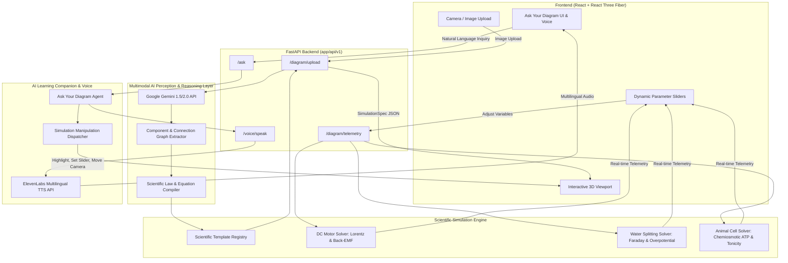

# Paper2Lab 🔬⚡
> **"Don't just read science. See it. Interact with it. Experiment with it. Understand it."**

Paper2Lab is an AI-powered, multilingual virtual science laboratory that transforms ordinary textbook diagrams and scientific illustrations into interactive 3D simulations.

---

## 🏛️ System Architecture



---

## 🚀 Quickstart Backend

### Prerequisites
- Python 3.10+
- Pip

### Setup & Run
```bash
cd backend
# Run the FastAPI server
python run.py
```

The server starts at `http://localhost:8000`
- **Swagger Interactive API Docs:** `http://localhost:8000/api/v1/docs`
- **Health Check:** `http://localhost:8000/api/v1/health`

### Environment Variables (.env)
```env
GEMINI_API_KEY="your-gemini-api-key"
ELEVENLABS_API_KEY="your-elevenlabs-api-key"
```
*(Note: If keys are omitted during offline development, Paper2Lab automatically activates its intelligent heuristic simulation solvers and test synthesizer so the entire stack works offline!)*

---

## 🧪 Running Tests
```bash
$env:PYTHONPATH="E:\PROJECTS-2nd Year\Paper2Lab\Paper2Lab\backend"
pytest backend/tests/test_api.py -v
```
All 8 test suites pass, covering multimodal upload, telemetry equation solvers, agentic simulation actions, and multilingual audio.
